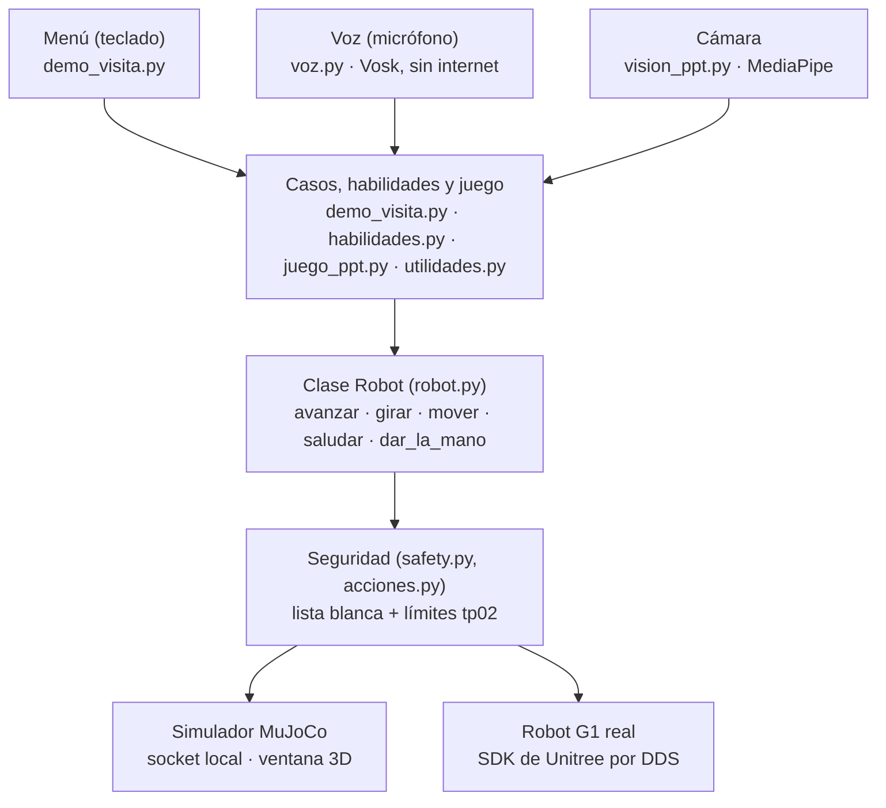

# TPO - Inteligencia Artificial: cambios en la demo del G1

## Resumen

El proyecto está en GitHub y la demo del humanoide G1 suma habilidades nuevas, control manual, control por voz y piedra, papel o tijera con cámara. El menú original sigue funcionando y convive con la voz.

- **Repositorio:** github.com/gcayo/TPO-Inteligencia-Artificial, rama `main`.
- **Menú:** 14 opciones, más `t` para toda la secuencia. El modo voz se arranca con `bash INICIAR_VISITA.command voz`.
- **Seguridad:** todo usa solo los movimientos permitidos por el proyecto, así que funciona igual en el robot real.
- **Pruebas:** la lógica se probó con un robot simulado.

## Qué es el proyecto

Es un laboratorio para programar robots Unitree (el humanoide G1 o el perro Go2) sin tenerlos adelante: el código se prueba en un simulador y después corre igual en el robot real.

- **El simulador** usa MuJoCo y los modelos oficiales de Unitree. Abre una ventana 3D con el robot y corre entero en la computadora, sin internet.
- **La API del alumno** es una clase `Robot` con órdenes simples: `avanzar`, `girar`, `mover`, `detenerse`, `saludar`, `dar_la_mano`. Todo se expresa en velocidad y tiempo; la distancia es velocidad × tiempo.
- **Las materias** comparten el mismo entorno con límites propios (tp01 a tp07). El paquete está armado para el TP02 de Programación I: un controlador de misiones que valida comandos, ejecuta los válidos, rechaza los inválidos y hace un reporte.
- **La visita** es la demo para el día en que el G1 real va al aula: un menú de casos de uso en `mi_desarrollo/demo_visita.py`. Esta es la parte que se amplió.

### Cómo se usa

1. En la Terminal de la Mac, dentro de la carpeta del proyecto: `bash INICIAR_VISITA.command`. Instala lo que falte, abre el simulador con el G1 y muestra el menú.
2. Se elige una opción por número. Para manejar el robot con la voz: `bash INICIAR_VISITA.command voz`.
3. El día de la visita, el mismo programa se conecta al robot físico en lugar del simulador.

## Cómo encaja todo

Las tres formas de controlar el robot terminan en las mismas funciones, y toda orden pasa por la capa de seguridad antes de llegar al simulador o al robot real.

El código de la demo es el mismo en los dos destinos; solo cambia el último tramo.

## Cómo se hizo

Se trabajó sobre el código existente sin tocar el entorno del simulador: todo lo nuevo vive en `mi_desarrollo/` y usa la misma clase `Robot` que los alumnos.

### El proceso

1. **Leer el proyecto.** Se revisaron la demo, la API `Robot` y los archivos de seguridad. Ahí apareció la lista blanca de movimientos, que definió qué habilidades eran posibles.
2. **Separar utilidades.** Las funciones para moverse en metros y grados y para hablar se pasaron de `demo_visita.py` a `utilidades.py`, para que las usen todos los módulos nuevos.
3. **Habilidades.** Cada una se escribió como una función `caso_...` que combina órdenes permitidas, con el mismo formato que los casos originales. Se diseñaron simétricas para que el robot vuelva a su lugar.
4. **Voz.** Se separó en dos partes: `Oyente`, que pasa del micrófono a texto, e `interpretar`, que pasa del texto a una orden. Así la parte que entiende las frases se prueba sin micrófono.
5. **Cámara.** También en dos partes: la detección de la mano (MediaPipe) y el clasificador, una función que solo mira los 21 puntos y decide la jugada.
6. **Juego.** `juego_ppt.py` tiene la ronda en común; teclado, cámara y voz solo cambian cómo se lee la jugada del alumno.
7. **Integración.** El menú suma las opciones nuevas. El modo voz llama a las mismas funciones que el menú.
8. **Instalación y documentación.** El lanzador instala los extras y `LEEME_VISITA.md` explica el uso.
9. **Ajustes al menú.** Se sacaron el moonwalk, el cangrejo, el vigía, el separador "Habilidades nuevas", los textos entre paréntesis y la opción `v` del menú (la voz se arranca por argumento).

### Decisiones de diseño

| Decisión | Por qué |
| --- | --- |
| Solo movimientos de la lista blanca | Lo que corre en el simulador tiene que correr igual en el robot real |
| Vosk en lugar de un servicio en la nube | Funciona sin internet; el wifi del aula no siempre ayuda |
| Palabra clave "robot" y máximo 1 m por orden de voz | Que una charla no mueva al robot y que un error de reconocimiento no lo lleve lejos |
| El micrófono se abre solo mientras escucha | Que el robot no se escuche a sí mismo |
| Clasificar por distancias a la muñeca | Funciona con la mano rotada o de costado |
| Votar la jugada durante 1.2 s | Un cuadro mal detectado no decide la ronda |
| La cuenta regresiva corre en un hilo aparte | En macOS la ventana de la cámara tiene que vivir en el hilo principal |
| Cámara en un proceso aparte si hace falta | MediaPipe tarda en salir para cada Python nuevo |
| Voz y cámara opcionales | Si no se instalan, el menú y el juego con teclado funcionan igual |

## Límites de seguridad

Las habilidades nuevas combinan solo los movimientos que el proyecto permite, porque la lista blanca de `entorno/sim/acciones.py` rechaza todo lo demás.

- **Permitido:** `mover`, `avanzar`, `girar`, `detenerse`, `saludar` y `dar_la_mano` (este último solo en el G1).
- **Prohibido:** saltos, acrobacias, rutinas de baile del SDK, sentarse y cualquier cambio de postura.
- **Límites del perfil tp02** (`entorno/sim/safety.py`): 0.20 m/s, 0.5 rad/s y 10 s por orden. Los movimientos largos se parten en tramos para no pasarse.

No se modificó ningún archivo de `entorno/`. Lo que anda en el simulador anda igual en el robot físico.

## El menú

| Opción | Caso | Qué hace |
| --- | --- | --- |
| 1 | Entrada | Entra al aula y saluda |
| 2 | Saludo al aula | Saluda a la izquierda, al centro y a la derecha |
| 3 | Dar la mano | Se acerca a un alumno y le da la mano |
| 4 | Cuadrado | Recorre un cuadrado de 0.4 m |
| 5 | Curva | Avanza y gira a la vez con `mover()` |
| 6 | Baile | Coreografía con movimientos permitidos |
| 7 | Piedra, papel o tijera | Contra el robot, con el teclado |
| 8 | Despedida | Se despide y sale del centro de la escena |
| 9 | Presentación | Saluda, se presenta en voz alta, cuenta lo que sabe hacer y da la mano |
| 10 | Zigzag | Cuatro diagonales alternadas (0.9 m) y vuelve marcha atrás |
| 11 | Ocho | Un círculo a la izquierda y otro a la derecha, de 30 cm de radio |
| 12 | Celebración | Saludo, vaivén corto, vuelta entera y otro saludo |
| 13 | Control manual | Se maneja con el teclado |
| 14 | Piedra, papel o tijera con cámara | El robot ve tu mano |
| t | Toda la secuencia | Corre las opciones 1 a 8 |

Las opciones 9 a 14 son nuevas. Las figuras nuevas son cerradas: el robot termina donde empezó.

### Control manual

| Tecla | Hace |
| --- | --- |
| `w` / `s` | Adelante / atrás 20 cm |
| `a` / `d` | Gira 45° a la izquierda / derecha |
| `z` / `c` | Paso al costado izquierdo / derecho |
| `h` | Saludar |
| `m` | Dar la mano |
| `q` | Volver al menú |

Se pueden escribir varias letras juntas: `wwa` avanza dos veces y gira a la izquierda.

## Control por voz

Arrancando con `bash INICIAR_VISITA.command voz`, el robot obedece órdenes habladas en castellano; diciendo "robot, menú" se pasa al menú.

### Cómo funciona

1. El reconocimiento usa Vosk, que funciona sin internet. Solo la primera vez baja el modelo en español (unos 40 MB).
2. El vocabulario está limitado a las palabras de las órdenes, lo que mejora mucho la precisión.
3. Cada orden tiene que empezar con la palabra clave **"robot"**. Si se dice solo "robot", contesta "¿Sí?" y espera la orden 8 segundos.
4. El robot confirma en voz alta ("Avanzo 50 centímetros") y ejecuta.
5. El micrófono solo está abierto mientras escucha, así el robot no se oye a sí mismo.

### Órdenes que entiende

| Decí… | Hace |
| --- | --- |
| robot, avanzá un metro / dos pasos / un poco | Camina hacia adelante (1 paso = 20 cm) |
| robot, retrocedé medio metro | Camina hacia atrás |
| robot, girá a la izquierda / a la derecha un poco | Gira 90° (o 45°) |
| robot, paso al costado a la derecha | Se corre sin girar |
| robot, media vuelta / vuelta entera | Gira 180° / 360° |
| robot, saludá / saludá a todos / dame la mano | Gestos |
| robot, bailá / cuadrado / curva / zigzag / ocho / festejá / presentate / chau | Coreografías |
| robot, juguemos a piedra, papel o tijera | El juego, con cámara si hay |
| robot, pará / ayuda / menú | Detenerse / explicar / volver al menú |

### Seguridad

- Por voz se mueve como máximo 1 metro por orden; si se pide más, avisa y hace 1 metro.
- La palabra clave evita que una charla del aula mueva al robot.
- Mientras hace un movimiento no escucha; para frenarlo en el medio se usa Ctrl+C.

## Piedra, papel o tijera con cámara

La cámara encuentra la mano con MediaPipe y decide la jugada contando qué dedos están estirados.

### Cómo reconoce el gesto

MediaPipe devuelve 21 puntos de la mano. Un dedo cuenta como estirado si su punta está al menos 15% más lejos de la muñeca que su nudillo del medio. Comparar distancias, y no alturas, hace que funcione con la mano inclinada o de costado.

| Dedos estirados (índice, medio, anular, meñique) | Jugada |
| --- | --- |
| Ninguno | Piedra |
| Índice y medio, los otros doblados | Tijera |
| Tres o cuatro | Papel |
| Otra combinación | No cuenta |

### Cómo es una ronda

1. El robot dice "piedra, papel, tijera" con un vaivén por palabra, mientras la ventana muestra la cámara en vivo.
2. Al decir "tijera", la cámara mira la mano 1.2 segundos y se queda con la jugada que más vio.
3. Si no vio una mano clara, el robot dice "Repetimos" y la ronda no cuenta.
4. El robot elige al azar y reacciona: saluda si gana, da la mano si pierde y hace un vaivén si empatan.

La ventana muestra los puntos de la mano y lo que detecta ("Veo: TIJERA"); `q` o `Esc` termina el juego.

### Si algo falta

- Si no hay cámara o faltan las librerías, el juego pasa al teclado (en el menú) o a decir la jugada en voz alta (en el modo voz).
- MediaPipe todavía no sale para cada Python nuevo. En ese caso, la cámara corre en un proceso aparte con un Python 3.10 a 3.12 que arma el instalador.
- Soporta la API vieja de MediaPipe y la nueva; la versión actual (0.10.32) solo trae la nueva.

## Archivos nuevos y modificados

Todo lo nuevo está en `mi_desarrollo/`; nada dentro de `entorno/` cambió.

| Archivo | Estado | Qué tiene |
| --- | --- | --- |
| `mi_desarrollo/utilidades.py` | Nuevo | Moverse en metros, grados y de costado en tramos; hablar con la voz del sistema (macOS, Linux o Windows) |
| `mi_desarrollo/habilidades.py` | Nuevo | Presentación, zigzag, ocho, celebración y control manual |
| `mi_desarrollo/voz.py` | Nuevo | `Oyente` (micrófono a texto con Vosk) e `interpretar` (texto a orden) |
| `mi_desarrollo/vision_ppt.py` | Nuevo | Detección de la mano, clasificador de gestos, ventana de la cámara y modo de proceso aparte |
| `mi_desarrollo/juego_ppt.py` | Nuevo | Piedra, papel o tijera con teclado, cámara o voz |
| `mi_desarrollo/requirements-extras.txt` | Nuevo | Librerías opcionales: vosk, sounddevice, mediapipe, opencv-python |
| `mi_desarrollo/demo_visita.py` | Modificado | Menú de 14 opciones y modo voz; el juego pasó a `juego_ppt.py` |
| `INICIAR_VISITA.command` | Modificado | Instala la voz y la cámara; si hace falta, arma el Python aparte para MediaPipe |
| `LEEME_VISITA.md` | Modificado | Guía de uso: menú, órdenes de voz, juego, Windows y permisos |
| `DOCUMENTACION.md` | Nuevo | Este documento |

## Instalación y requisitos

En la Mac alcanza con correr `bash INICIAR_VISITA.command` en la Terminal, dentro de la carpeta del proyecto: instala lo que falte y abre todo. La primera vez necesita internet.

1. Crea un entorno de Python en `~/.venvs/unitree` (Python 3.10 o más nuevo).
2. Instala MuJoCo, que es obligatorio.
3. Instala `vosk` y `sounddevice` para la voz. Si falla, sigue sin voz.
4. Instala `mediapipe` para la cámara. Si no hay versión para ese Python, busca un Python 3.10 a 3.12 y arma `~/.venvs/unitree-vision`. Si no encuentra ninguno, sigue sin cámara.
5. Abre el simulador con el G1 y la demo.

### Otros requisitos

- **Bloqueo de macOS:** si macOS no deja abrir los archivos bajados, en la carpeta del proyecto: `xattr -dr com.apple.quarantine .`
- **Permisos en macOS:** la primera vez pide acceso al micrófono y a la cámara para la Terminal. Si se rechazó: Configuración del Sistema → Privacidad y seguridad.
- **Linux:** la voz necesita PortAudio (`sudo apt install libportaudio2`).
- **Windows:** se abre `INICIAR_SIMULADOR.bat`, se instalan los extras con `python -m pip install -r mi_desarrollo\requirements-extras.txt` y se corre `python mi_desarrollo\demo_visita.py`.
- **Descargas de la primera vez:** el modelo de voz en español (unos 40 MB) y, con MediaPipe nuevo, el modelo de manos.

## Pruebas

La lógica se probó entera con un robot simulado que aplica la misma validación de seguridad que el real y calcula la posición con un reloj virtual.

| Prueba | Resultado |
| --- | --- |
| Todas las coreografías, contra los límites de tp02 | 0 rechazos por seguridad; las nuevas vuelven a x = 0, y = 0, rumbo 0° |
| Intérprete de voz con frases de prueba | Todas entendidas; la charla sin "robot" se ignora; pedir 5 m da 1 m con aviso |
| Clasificador con 1000 manos sintéticas, rotadas y a distintas escalas | 1000 correctas |
| Captura de la cámara con OpenCV y cuadros simulados, con y sin ventana | Piedra, papel y tijera bien detectadas; sin mano devuelve "no vi" |
| Proceso aparte de la cámara | Rondas, cancelación con `q` y cierre funcionan |
| Menú, control manual, modo voz y juego por cámara, de punta a punta | Funcionan; sin voz o sin cámara, avisan y siguen con el teclado |

Las pruebas encontraron dos errores que se corrigieron: un fallo al bajar el modelo de manos cortaba el programa, y en Linux sin pantalla OpenCV cerraba el proceso.
